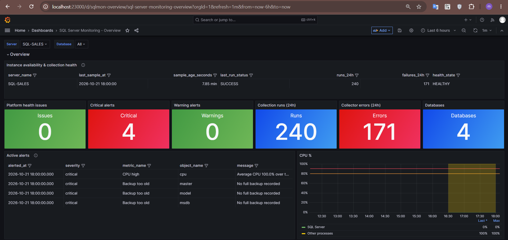
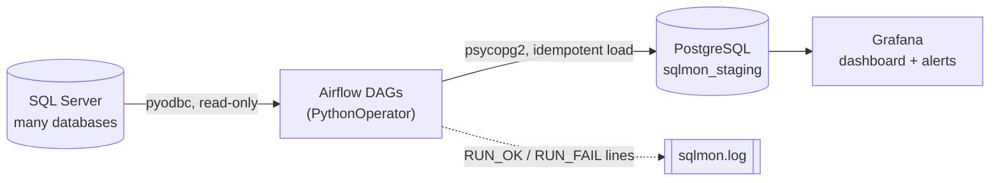
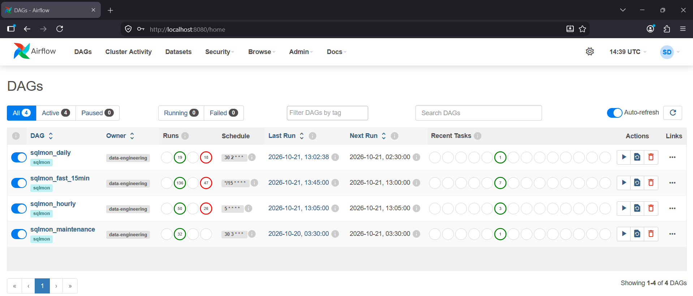

# SQL Server Monitoring with Airflow, PostgreSQL and Grafana


Agentless, read-only monitoring for Microsoft SQL Server. Airflow runs T-SQL collectors against the instance
(every 15 minutes, hourly or nightly depending on cost), stores the results as time series in a PostgreSQL
staging database, and Grafana turns them into an operations dashboard with computed alerts.



## What you get

- **33-panel Grafana dashboard** (Overview, Hardware, Databases, Workload, High availability, Collection pipeline)
  with `Server` and `Database` selectors, built-in panels only (no plugins).
- **11 collectors**, one Airflow task each, so one failing metric never blocks the others.
- **8 computed alert rules** (disk, CPU, memory pressure, log usage, backups, offline databases, Availability
  Groups, stalled collectors). They are SQL views over the latest snapshots, so alerts close by themselves.
- **Safe by design**: a read-only login, a pool that limits concurrent queries, idempotent loads and a plain-text
  run log that keeps working even when Airflow or PostgreSQL is down.

## Architecture



| DAG | Schedule | Collectors |
|---|---|---|
| `sqlmon_fast_15min` | every 15 min | `cpu`, `memory`, `disk_volume`, `db_inventory`, `workload`, `waits`, `ha` |
| `sqlmon_hourly` | hourly at :05 | `db_files` (files, filegroups, FILESTREAM filegroups), `db_log`, `tables` |
| `sqlmon_daily` | 02:30 | `fragmentation` (heavy, run off-peak) |
| `sqlmon_maintenance` | 03:30 | retention purge (default 90 days) |

## Collected metrics

| Area | Details | Main source |
|---|---|---|
| CPU | SQL Server vs. other processes vs. idle, 15-minute average | `sys.dm_os_ring_buffers` |
| Memory | OS total/available, SQL process memory, max/target/total server memory, page life expectancy | `sys.dm_os_sys_memory`, `sys.dm_os_process_memory`, performance counters |
| Disk | free space per volume that hosts database files | `sys.dm_os_volume_stats` |
| Databases | state, recovery model, data/log size, last full and log backup | `sys.databases`, `sys.master_files`, `msdb.dbo.backupset` |
| Files | allocated vs. used space per file and filegroup, growth settings | `sys.database_files`, `FILEPROPERTY` |
| Transaction log | size and percent used per database | `sys.dm_db_log_space_usage` |
| Tables | rows, reserved/data/index size, top 100 per database | `sys.dm_db_partition_stats` |
| Indexes | fragmentation (LIMITED scan, indexes of 1000+ pages, worst 200 per database) | `sys.dm_db_index_physical_stats` |
| Workload | batch requests/sec, sessions, blocked requests, page reads/writes, memory grants | `sys.dm_os_performance_counters`, `sys.dm_exec_*` |
| Waits | top 25 waits, shown as per-interval deltas in Grafana | `sys.dm_os_wait_stats` |
| High availability | Availability Group replica and database synchronization health | `sys.availability_*`, `sys.dm_hadr_*` |

## Requirements

| Component | Version |
|---|---|
| SQL Server | 2014 or newer (`CONNECT ANY DATABASE`); developed against 2022 Express on Linux |
| Python | 3.10 |
| Apache Airflow | 2.10.x (any 2.4+ should work); `LocalExecutor` with a PostgreSQL metadata database |
| Microsoft ODBC Driver for SQL Server | 18 (`msodbcsql18`) |
| PostgreSQL | 14 or newer (the dashboard uses `date_bin`); developed against 16 |
| Grafana | 9.5 or newer |

## Repository layout

```
.
├── airflow/dags/
│   ├── sqlmon_dags.py              # DAG factory: one DAG per schedule tier
│   ├── .airflowignore              # keeps Airflow from parsing the library package as a DAG
│   └── sqlmon/
│       ├── config.py               # metric registry, schedules, connection ids
│       ├── collector.py            # extract -> idempotent load -> audit + file log
│       ├── logger.py
│       └── queries/*.sql           # one T-SQL file per collector
├── mssql/01_create_monitor_login.sql
├── postgres/
│   ├── 01_create_db_and_roles.sql  # database + sqlmon_etl (rw) + grafana_ro (read-only)
│   ├── 02_schema.sql               # tables, indexes, retention function, freshness view
│   ├── 03_dashboard_views.sql      # computed alerts + collection health
│   └── 04_cleanup_late_rows.sql    # optional repair script
├── grafana/
│   ├── build_dashboard.py          # generates the dashboard JSON (and checks threshold sync)
│   ├── sqlmon_dashboard.json       # ready to import
│   └── provisioning/               # data source + dashboard as code
├── scripts/start_all.sh            # dev helper: bring the lab up after a reboot
└── .env.example
```

## Quick start

### 1. PostgreSQL staging database

Edit the two passwords in `postgres/01_create_db_and_roles.sql`, then:

```bash
sudo -u postgres psql < postgres/01_create_db_and_roles.sql
psql -h localhost -U sqlmon_etl -d sqlmon_staging -f postgres/02_schema.sql
psql -h localhost -U sqlmon_etl -d sqlmon_staging -f postgres/03_dashboard_views.sql
```

### 2. Read-only login on every SQL Server instance

```bash
sqlcmd -S <server> -U <admin> -P '<admin password>' -C \
       -v MONITOR_PASSWORD='<strong password>' -i mssql/01_create_monitor_login.sql
```

The login gets `VIEW SERVER STATE`, `VIEW ANY DEFINITION`, `CONNECT ANY DATABASE` and `SELECT` on
`msdb.dbo.backupset`. Nothing else. All three server-level grants are required: without them the per-database
panels stay empty.

### 3. Airflow

```bash
pip install "apache-airflow==2.10.5" \
  --constraint "https://raw.githubusercontent.com/apache/airflow/constraints-2.10.5/constraints-3.10.txt"
pip install -r requirements.txt            # pyodbc, psycopg2-binary
# install the Microsoft ODBC Driver 18 for SQL Server (msodbcsql18) for your OS

cp -r airflow/dags/. "$AIRFLOW_HOME/dags/"   # includes .airflowignore

airflow connections add mssql_monitor --conn-type generic \
  --conn-host <sql-server-host> --conn-port 1433 \
  --conn-login sqlmon_reader --conn-password '<MONITOR_PASSWORD>' --conn-schema master \
  --conn-extra '{"driver":"ODBC Driver 18 for SQL Server","trust_server_certificate":"yes","server_name":"MY-SQL01"}'

airflow connections add pg_monitoring --conn-type postgres \
  --conn-host localhost --conn-port 5432 \
  --conn-login sqlmon_etl --conn-password '<sqlmon_etl password>' --conn-schema sqlmon_staging

airflow pools set sqlmon_mssql 3 "limit concurrent queries against SQL Server"
```

Test one collector, then enable the DAGs:

```bash
airflow tasks test sqlmon_fast_15min collect_cpu 2026-01-01T00:00:00
psql -h localhost -U sqlmon_etl -d sqlmon_staging -c "select metric, status, rows_loaded from mon.etl_run_log order by id desc limit 3;"

for d in sqlmon_fast_15min sqlmon_hourly sqlmon_daily sqlmon_maintenance; do airflow dags unpause $d; done
```

`trust_server_certificate` is for labs and self-signed certificates. Use a trusted certificate in production.
Several instances: create one connection per instance and set `SQLMON_MSSQL_CONNS=mssql_a,mssql_b`.

### 4. Grafana

**Option A, import:** Dashboards -> New -> Import -> upload `grafana/sqlmon_dashboard.json` and pick a
PostgreSQL data source that connects as `grafana_ro` to `sqlmon_staging`.

**Option B, provisioning (survives container re-creation):** mount `grafana/provisioning` to
`/etc/grafana/provisioning` and a volume to `/var/lib/grafana`, and pass two environment variables:

```yaml
grafana:
  image: grafana/grafana:9.5.2
  environment:
    SQLMON_PG_HOST: host.docker.internal:5432
    GRAFANA_RO_PASSWORD: ${GRAFANA_RO_PASSWORD}
  volumes:
    - ./grafana_data:/var/lib/grafana            # chown 472:0 on Linux
    - ./grafana/provisioning:/etc/grafana/provisioning
  extra_hosts: ["host.docker.internal:host-gateway"]
```

PostgreSQL must accept the Grafana container: `listen_addresses`, plus a `pg_hba.conf` line for the user
`grafana_ro` limited to the Docker network.

### 5. Verify

```sql
select metric, last_ok_at, age, failures_24h from mon.v_data_freshness order by metric;
```

`age` should be a few minutes for the 15-minute collectors. Open the dashboard: the health table on top should say
`HEALTHY`.

## Configuration

| Environment variable | Default | Purpose |
|---|---|---|
| `SQLMON_MSSQL_CONNS` | `mssql_monitor` | comma-separated Airflow connection ids, one per SQL Server instance |
| `SQLMON_PG_CONN` | `pg_monitoring` | Airflow connection id of the staging database |
| `SQLMON_TZ` | `UTC` | time zone used to read the cron expressions (nightly jobs) |
| `SQLMON_RETENTION_DAYS` | `90` | how long metrics are kept |
| `SQLMON_LOG_DIR` | `~/sqlmon_logs` | directory of `sqlmon.log` |

Schedules and the collector registry live in `airflow/dags/sqlmon/config.py`.

## Alerts and thresholds

| Rule | Warning | Critical |
|---|---|---|
| CPU (SQL + other, 45-minute average) | > 80 % | > 90 % |
| Disk free space | < 20 % | < 10 % |
| Memory pressure | page life expectancy < 300 s | SQL process reports low memory |
| Transaction log used | > 80 % | > 90 % |
| Backup | | no full backup, or older than 26 h (tempdb excluded) |
| Database state | | not `ONLINE` |
| Availability Group | | unhealthy replica or database, suspended movement |
| Collector stale | | no successful run for 35 min (15-minute tier), 95 min (hourly), 26 h (daily) |

Thresholds live in two places on purpose: `postgres/03_dashboard_views.sql` (alert rules) and the constants at the
top of `grafana/build_dashboard.py` (dashboard colours and threshold lines). `build_dashboard.py` refuses to build
when they differ. To change one: edit both, run `python3 grafana/build_dashboard.py`, re-apply the SQL file and
re-import (or re-copy) the JSON.

## Design notes

- **Idempotent loads.** Every load is `DELETE` + `INSERT` in one transaction keyed by `(server_name, collected_at)`,
  so retries never create duplicates.
- **Late runs are not back-dated.** DMVs are point-in-time snapshots. A run that starts more than 10 minutes after
  its planned time (retries, Airflow was down) is stamped with the real time and logs `RUN_LATE`.
- **Counters are stored raw.** Cumulative counters (batch requests, waits) are differenced in Grafana, and a reset
  after an instance restart is dropped instead of plotted as a negative spike.
- **Protecting production.** All tasks share the `sqlmon_mssql` pool (3 slots); heavy collectors run less often and
  are capped (top 100 tables, 200 worst indexes per database).
- **Two independent trails.** `mon.etl_run_log` records every run; `sqlmon.log` records the same events in plain text
  (`grep -E "RUN_(OK|PARTIAL|FAIL|LATE)" ~/sqlmon_logs/sqlmon.log`). The file works without Airflow or PostgreSQL.
- **One broken database is not fatal.** Per-database collectors skip a database that cannot be queried and finish as
  `PARTIAL`.

## Operations

- After a reboot of a dev machine: copy `.env.example` to `.env`, fill it in, then `bash scripts/start_all.sh`
  (starts Docker and PostgreSQL, the containers, re-applies the login, starts Airflow). On real servers run Airflow
  and Grafana under systemd instead.
- Add a metric: put a `.sql` file in `airflow/dags/sqlmon/queries/` (column aliases must match the table), create
  the table in `postgres/02_schema.sql`, register it in `config.py`, add panels in `build_dashboard.py`.
- Gaps cannot be back-filled. Downtime shows up as missing data and in the "Last successful run" panel.

## Troubleshooting

| Symptom | Cause and fix |
|---|---|
| `Login failed for user 'sqlmon_reader'` | the login does not exist (new container without a volume?) or the password differs from the Airflow connection. Re-run `mssql/01_create_monitor_login.sql`. |
| Airflow shows an import error for `sqlmon/collector.py` | `airflow/dags/.airflowignore` was not copied (`cp -r airflow/dags/.` includes it). |
| Per-database panels say "No data" | the login lacks one of the grants, so `db_inventory` fails and the `Database` variable is empty. Check `select metric, left(error_text,150) from mon.etl_run_log where status <> 'SUCCESS' order by id desc limit 10;`. |
| "Failed collector runs" is flat at 0, "Availability groups" shows one text row | expected: no failures, no Availability Groups. |
| `can't find ODBC driver` | install `msodbcsql18` and check `odbcinst -q -d`. The Windows driver name `{SQL Server}` does not work on Linux. |
| Grafana cannot connect to PostgreSQL | `listen_addresses`, a `pg_hba.conf` line for `grafana_ro`, and a real host name instead of a placeholder in `SQLMON_PG_HOST`. |
| Grafana starts empty after every restart | `/var/lib/grafana` is not mounted from the host. |

## Security notes

- The monitoring login is read-only; scripts never contain real passwords. Keep `.env` out of git (it is ignored).
- Passwords reach Airflow through connections, and Grafana through environment variables.
- The `SA` password in `.env` is only for the throw-away lab container used by `scripts/start_all.sh`.

## Known limitations and roadmap

- Metrics come from SQL Server DMVs only. Non-database disks, OS counters and the real size of FILESTREAM folders
  need an OS-level agent (for example a Prometheus exporter).
- Missing/unused index analysis, long-running transactions, deadlocks, SQL Agent job failures and error-log
  scanning are not collected yet.
- Large estates (hundreds of databases) may need table partitioning in PostgreSQL and per-instance DAG splitting.
- Alert rules are dashboard-level SQL views; Grafana alert rules and a contact point (email, Teams, Telegram)
  still have to be configured by hand.

## Testing status

- The PostgreSQL schema, the views, every dashboard query and the alert scenarios were executed against
  PostgreSQL 16 with synthetic data.
- The collectors ran end-to-end on SQL Server 2022 Express (Linux container) with Airflow 2.10.5 and Grafana 9.5.2
  at lab scale.
- **Not tested:** Always On clusters (the lab instance has no Availability Group, the collector returns zero rows),
  SQL Server versions before 2022, Windows hosts, multi-instance setups and production-sized databases.

## Contributing

Issues and pull requests are welcome. Please keep collectors read-only and describe the SQL Server version you
tested on.

## License

[MIT](LICENSE)

## Screenshots



## Author

Sajjad - [@sajiiii78](https://github.com/sajiiii78)
